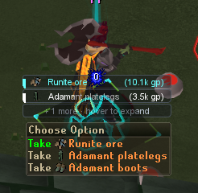
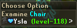

# Improved Right-Clicks

Make right-click menus easier to read and harder to misclick. Enable the protections you want, hide unwanted item options, color useful actions and add loot icons or player relationship badges. Save different setups for different activities.

## What you can do

- **Avoid item misclicks:** protect potion Empty and selected inventory actions, with separate bank protections.
- **Clean up menus:** control Examine, Cancel, Walk here and other supported entries, with exceptions and a reveal modifier.
- **Protect buttons:** choose normal, right-click-only or hidden modes for supported controls.
- **Make actions readable:** customize action colors, extra-option counts, loot icons and Native/OSRS menu styling.
- **Group ground loot:** combine matching ground-item entries into counted rows. Each click still performs one normal pickup.
- **Show player relationships:** add friend, ignore-list, Friends Chat and RuneLite party badges, plus an optional Copy name entry.
- **Save setups:** named profiles, import/export previews and Undo are available in the side panel.

## Getting started

1. Install **Improved Right-Clicks** from RuneLite’s Plugin Hub.
2. Open its normal RuneLite settings and enable the protections or presentation choices you want. Protection switches start off and button modes start at Normal.
3. Hold **Ctrl before opening a menu** to reveal options hidden by this plugin. The modifier can be changed to Shift, Alt or None.
4. Use the **Menus**, **Profiles** and **Tools** sidebar tabs for settings access, saved setups and diagnostics.

**General → Hide side panel** removes the toolbar icon while menu features remain active. Clear it in RuneLite’s normal plugin settings to access profiles and tools again.

## Item rules and presentation

Use one `action,item name` rule per line. Matching ignores case; `*` matches any text. Optional `[inventory]`, `[bank]`, `[ground]` and `[all]` prefixes limit the context. Allowed-item exceptions retain supported actions that would otherwise be hidden.

Hold **Shift while opening a menu** for the local menu-color editor. Exact color mappings override wildcard mappings. Native rank icons and existing name colors are preserved when player badges are added.

In the Hub version, **Presentation → Group ground Examine at bottom** optionally moves ground-item Examine just above Cancel without changing Take order. It works independently of duplicate grouping.

## Loot icons and other menu plugins

Under **Presentation**, enable **Ground loot icons** and select **Native**, **Custom** or **Both**. Improved Looting can supply custom images through **Connect menu icons** when compatibility is enabled. Ordinary menu features do not require an icon provider.

Item icons and action colors in an opened menu. The cards above the menu come from Improved Looting.

Automatic Loot Filters sharing needs its [provider update](https://github.com/riktenx/loot-filters/pull/219), which remains under review. Improved Right-Clicks does not read another plugin’s private icon files.

Keep Menu Entry Swapper for swaps and specialist plugins for features you still use. Disable overlapping filters or color rules when comparing results. The reveal modifier cannot restore an entry removed by another plugin.

## Account badges in development

Local test example. Account identification is development functionality and is not included in the currently Hub-pinned version.

The default branch includes an optional **Ironman identification (Beta)** preview that is not in the currently Hub-pinned version. It combines observed chat icons with Hiscores estimates. It starts off; enabling Hiscores requests sends the requested name and your IP address to Jagex.

Observed icons take priority. Hiscores results are labeled estimates and can be stale; unknown or contradictory results stay unknown. Group variants come from chat observations. The preview uses a bounded, expiring profile cache and disables identification in PvP/Wilderness and special worlds. See the [full explanation and expiry table](docs/guide.md#development-preview-ironman-identification) before enabling it.

## Saving and support

Existing settings from **Menu Workshop** are retained. Saved profiles and validated imports apply this plugin’s settings; Undo restores the changes made by the relevant operation without overwriting unrelated later edits.

See the [full guide](docs/guide.md) for rule examples, item exceptions, badges, image providers, limits and compatibility. [Report an issue or suggest a feature](https://github.com/wukuna/improved-right-clicks/issues) with the affected menu, settings and other menu plugins.

## License and attribution

The project uses [BSD 2-Clause](LICENSE). Adapted projects and bundled RS2F components retain their notices in [THIRD_PARTY_NOTICES.md](THIRD_PARTY_NOTICES.md) and the resources. Additional project credits are retained in the [full guide](docs/guide.md#inspiration-and-recipe).
